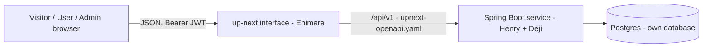

# up-next: intent, design and split

A public feedback board and roadmap. Side project proposed by Ehimare J. Okosun (Team 2). Held to the **side-project standard**: lighter than ClinicFlow, but still real. It adds no marks to the 100, and is evidence for "Your own contribution" and "Collaboration". **If time runs short, ClinicFlow is protected and up-next shrinks.** Tell Laja on Friday, not Monday.

Status: v0.1, 24 Oct 2026 · Contract: `openapi/upnext-openapi.yaml` (validates) · Schema: `db/migration/V1`, `V100` (applied and tested on a real Postgres)

---

## 1. Intent

**Problem.** Feedback arrives by email, tickets, WhatsApp and social media. Good ideas get lost, the same request arrives in different words, nobody can tell how many people want something, and users never learn whether they were heard.

**Users.** Visitors (browse and read the roadmap, no account) · Users (submit, vote) · Admins (the product team: move cards).

**Goal.** One transparent place where requests are collected, demand is measured by **one vote per user**, and progress is visible on a public roadmap.

**Out of scope / later.** Comments with a Team badge (Should) · merging duplicates (rule decided, built after Monday) · embeddable widget, AI duplicate detection, live updates, email. Anything simulated is labelled; all data is fictional; no claim of a real product or customers.

### Monday journey (definition of done, from the brief)
1. A user signs up, submits a request, another user upvotes it. An admin drags it to Planned and it appears on the public roadmap. (Deployed service, not the mock.)
2. The vote count updates immediately. When the service refuses the vote, the count reverts and a message explains.
3. **Two simultaneous votes from the same user record one vote**, with a test that fails when the unique constraint is removed.
4. Seed data: at least 40 requests across all four statuses, long titles, one with no tags, one with no votes.

---

## 2. Rules and where they are protected

| Rule | Protected by | Test (must fail when the protection is removed) | Owner |
|---|---|---|---|
| One vote per user per request, even for two taps at once | `PRIMARY KEY (request_id, user_id)` + `INSERT ... ON CONFLICT DO NOTHING` | 8 simultaneous `PUT /vote` from one user leave one vote. **Verified at database level: 1 vote with the key, 8 without.** | Deji (logic), Henry (HTTP test, pipeline) |
| Status changes are admin-only, in the service | `SecurityConfig` rule on `/requests/*/status` and `/board` | A USER token calls `PUT .../status` directly and gets 403; test fails when the rule is deleted | Henry |
| Every move stored with who and when | `request_status_history`, appended in the same transaction as the move | Move a card, read history, expect one row with the admin's name | Deji |
| Two admins, one card: one wins, the other sees the true column | `UPDATE ... WHERE id = ? AND version = ?` (compare and set) | Two simultaneous moves with the same `expectedVersion` give one 200 and one 409 `STALE_VERSION` carrying `current`. **Verified at database level: [1, 0] with the check, [1, 1] without.** | Deji |
| Roadmap is always consistent with the board | Roadmap is a query over `request.status`, not a copy | Move a card; board and roadmap agree | Deji |
| Voting closes when a request is COMPLETED | Service rule, `409 VOTING_CLOSED` | Vote on a completed request is refused | Deji |
| Same email, any letter case, one account | `UNIQUE (lower(email))` | 6 simultaneous signups with one email in mixed case give one account. **Verified: 1 account.** | Henry (signup), V100 |

**Voting design.** Two explicit calls, `PUT /vote` and `DELETE /vote`, instead of one toggle. The brief wants both "voting again removes the vote" and "two taps in quick succession record one vote", which a toggle cannot do (two taps would add then remove). With explicit calls, the screen sends DELETE when `viewerHasVoted` is true, and two quick taps send the same call twice, which is a no-op the second time.

**Why `VOTING_CLOSED` exists.** The brief says "when the service is made to refuse the vote, the count reverts and a message explains". We need a real, demonstrable refusal. Voting on a COMPLETED request is a sensible product rule and gives the interface something honest to revert on. *Assumption: confirm with Laja.*

---

## 3. Design



- **Separate repos and deployments:** `upnext-api` and `upnext-web`. Own database. Check your provider's free-project limits and record whether ClinicFlow and up-next share an account (the brief asks).
- **Same pattern as ClinicFlow:** `web` (Henry) and `domain` (Deji) meeting only at `domain.port`. Copy `RequestIdFilter`, `Json`, `Hashes`, `JwtService`, `ProblemWriter`, `CurrentActor`, the error handler and the security config from `clinicflow-api` and adapt. That is why this should take hours, not days.
- **Optional auth:** `GET /requests`, `GET /requests/{id}` accept a token when present (to fill `viewerHasVoted`) and work without one. In `SecurityConfig` they are `permitAll`, and the controller reads the principal if one exists.

### Ports (the seam), sketch
```java
public record Actor(UUID userId, String label, ActorRole role, String requestId) {}   // role: USER, ADMIN, SYSTEM
public interface RequestPort {
    RequestView create(CreateCommand c, Actor actor);                 // starts OPEN; tags lower-cased, de-duplicated
    PageResult<RequestView> search(BrowseFilter f, UUID viewerId);    // tag, status, q, sort, page, size; hides duplicates
    RequestView get(UUID id, UUID viewerId);
    List<TagCount> tags();
}
public interface VotePort {
    VoteState cast(UUID requestId, UUID userId);      // idempotent; VotingClosedException if COMPLETED
    VoteState withdraw(UUID requestId, UUID userId);  // idempotent; VotingClosedException if COMPLETED
}
public interface BoardPort {
    RequestView move(UUID id, Status target, int expectedVersion, Actor admin);   // StaleVersionException(current)
    List<HistoryView> history(UUID id);
    BoardView board(UUID viewerId);
    RoadmapView roadmap(UUID viewerId);
}
```
Exceptions (Deji throws, Henry maps): `NotFoundException` 404 · `VotingClosedException` 409 `VOTING_CLOSED` · `StaleVersionException(RequestView current)` 409 `STALE_VERSION` · `EmailTakenException` 409 `EMAIL_TAKEN` (Henry's signup) · bean validation 422.

### Browse query (Deji)
`vote_count` is computed: `LEFT JOIN (SELECT request_id, count(*) c FROM vote GROUP BY request_id)`. Filter by tag with `tags @> ARRAY[?]` (GIN index), by status (partial index `ix_request_status_created`), keyword with `ILIKE` on title and description. Sort `votes` = count desc then newest; `newest` = `created_at desc`.
**Index deliberately not created:** trigram on title/description. The keyword search scans a few hundred rows at demo scale; revisit if requests exceed about 50,000.

---

## 4. Decisions (side project needs two; here are three, each with a rejected alternative, a cost, and a reversal trigger)

**ADR-U1: Explicit PUT/DELETE vote instead of a toggle.** *Rejected:* `POST /vote` toggle (two taps cancel each other; not idempotent). *Cost:* the screen must know `viewerHasVoted` correctly, so a stale screen sends the wrong call (which is harmless: both are idempotent). *Reverse if* a native client appears that cannot track state.

**ADR-U2: Version check (compare and set) for moving cards.** *Rejected:* last write wins (silently loses an admin's move); pessimistic row locks held while a human drags a card. *Cost:* the losing admin sees a 409 and must look again. *Reverse if* admins complain about conflicts more than rarely, which would suggest per-column ordering instead.

**ADR-U3: Duplicate requests (the design problem with no clean answer).**
*Decision for the MVP:* a duplicate is merged by an admin into a target request: the duplicate is hidden (`duplicate_of` set, excluded from browse, board, roadmap), and the duplicate's voters are **copied to the target once per user** with `INSERT ... SELECT ... ON CONFLICT DO NOTHING`, so someone who voted on both counts once. The duplicate's own votes stay in place for audit. **Not built for Monday;** the column is in the schema and the rule is written down, so it is a *declared limitation*, not an oversight.
*Rejected:* auto-detection (Phase 2); deleting the duplicate (loses history and its author's context); summing counts (double counts people who voted on both).
*Cost:* the merge is not undone by the product (needs a manual fix), and the duplicate's author is not told. *Reverse if* admins merge wrongly often enough to need an "unmerge" action.

---

## 5. Who does what (Henry = API/auth/pipeline, Deji = Data and rules, Ehimare = interface)

| | Henry | Deji |
|---|---|---|
| Repo `upnext-api` | Create, skeleton, CI, Render service, Neon database, deploy hook | Review |
| Migrations | `V100` (`app_user`) + its down script | `V1` (`request`, `vote`, `request_status_history`) + down script |
| Code | `web`: signup, login, controllers, security rules, error mapping, request id, DTOs | `domain`: `RequestPort`, `VotePort`, `BoardPort` implementations, browse query, history |
| Tests | Role test (USER cannot move cards), voting-over-HTTP race, contract tests | Rule tests: vote, version check, voting closed, history, roadmap = board |
| Seed | Demo admin and user accounts | 40+ requests, votes, history |
| Docs | README, free-tier terms, decisions file | Data model note, seed note |

**Ehimare:** the contract is complete. Build the browse screen, the vote button (optimistic, reverts on failure), submit form, admin board (keyboard-operable drag, with arrow-key/button alternative), and public roadmap against the Prism mock on port 4011.

---

## 6. Schedule to Monday

| When | Henry | Deji |
|---|---|---|
| **Sun 25 morning** | `upnext-api` repo, skeleton copied from ClinicFlow, fake ports, deploy `/meta` live | `V1` applied locally; `VotePort` and `BoardPort.move` against Testcontainers |
| **Sun 25 afternoon** | Signup/login/roles, controllers, deploy | `RequestPort.create/search/get`, `roadmap`, `board`, seed |
| **Sun 25 evening** | Swap fake to real. Run the Monday journey on the deployed service. Concurrency test over HTTP | Confirm every seed state shows in the UI |
| **Mon 26 morning** | Warm both services 5 minutes before presenting | Rehearse |

**If behind on Sunday noon:** cut the board's `status-history` screen and `tags` endpoint first, then browse filters other than status. Never cut: signup, submit, vote (with the unique constraint), move card to Planned, roadmap. Declare every cut on the "what is simulated or not built" slide.

---

## 7. Risks

| Risk | Mitigation |
|---|---|
| Not enough time for both products | ClinicFlow first. up-next's pattern is copied, not invented. Tell Laja Friday-style early: do it now, not Monday. |
| Two services on one free account | Check Render and Neon free-project limits now; record the decision in the README |
| Vote race test passing without the constraint | Same "test bites" job as ClinicFlow: drop the primary key on a throwaway database and require the test to fail |
| `VOTING_CLOSED` is my assumption | Confirm with Laja; if rejected, force a refusal in the demo another way (for example a signed-out vote returns 401 and the screen reverts) |
